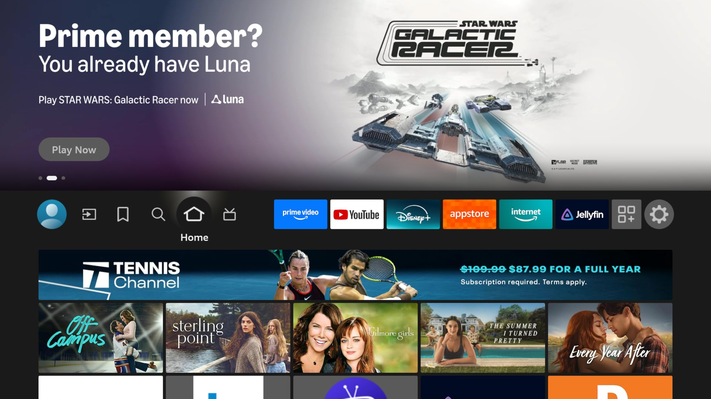
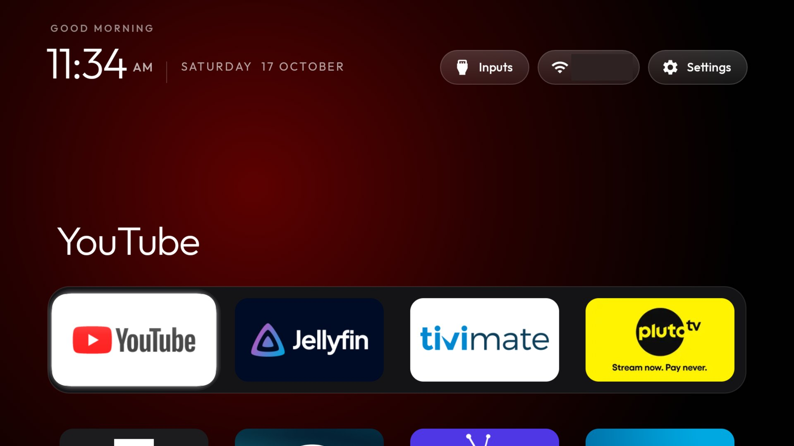
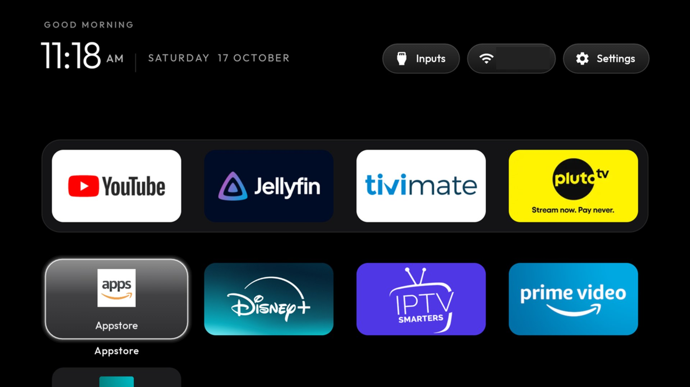
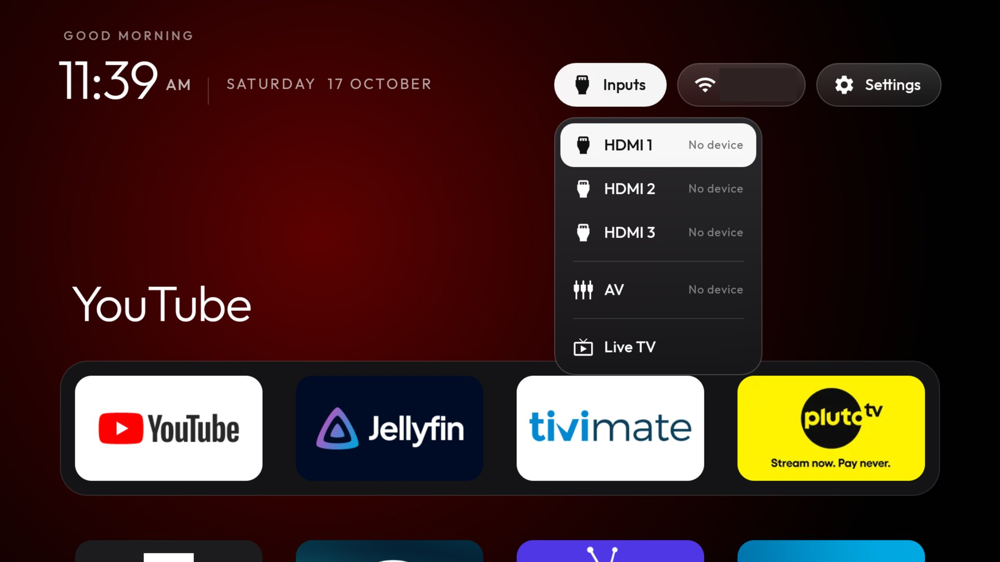
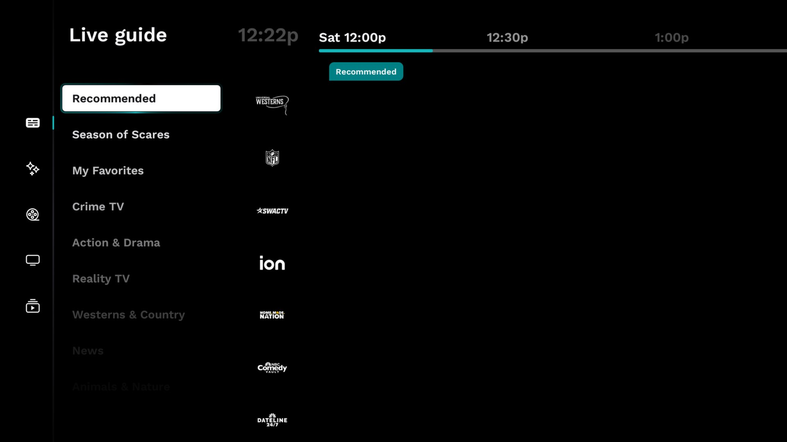

# Insignia Fire TV, debloated

How I removed the ads and lag from an Insignia NS-55DF710NA19 Fire TV Edition, and gave it a clean tvOS-style home screen, over ADB, with no root. This page covers everything that was changed and everything learned along the way.

The TV: Insignia 55" 4K Fire TV Edition, model `AFTJMST12` (codename keira), Fire OS 6.7.1.1, Android 7.1.2 (API 25), 1.5 GB RAM. Other Fire TV Edition sets and Fire TV sticks on Fire OS 6 or 7 should behave the same way, but check before running anything.

| Amazon's home | After |
|---|---|
|  |  |

What you get:

- **Fewer ads.** Ads, shopping, the extra Amazon apps and part of the telemetry are disabled. Interest-based ads are off.
- **Less lag.** Prime Video's background service, Amazon Live TV and most of Alexa are disabled, and animations run at half length. About 460 MB of RAM is available after boot, up from about 275 MB before.
- **A clean home screen.** The tvOS-style launcher from [`launcher/`](launcher/) shows when you press Home, even though Fire OS doesn't let you replace Amazon's home.
- **Working inputs.** HDMI 1-3, AV and the antenna play from the launcher's Inputs menu.
- **A working TV button.** The remote's TV button opens a live TV app of your choice. Here that's Xumo Play, which has free channels.

Everything is reversible. Packages are disabled with `pm disable-user --user 0`, never uninstalled. Each step below has its own undo script.

## Before you start

1. On the TV, go to Settings → My Fire TV → About and press OK on the device name seven times. This turns on Developer options. Then go back and turn on **ADB debugging**.
2. Find the TV's IP address under Settings → My Fire TV → About → Network.
3. On your computer, set up the Python ADB client: `python3 -m venv tools/venv && tools/venv/bin/pip install -r tools/requirements.txt`. Accept the "Allow USB debugging?" prompt on the TV the first time you connect.
4. Back up your package list and settings first, so you can always compare against the original state. Keep the `backup/` folder to yourself; it holds your TV's serial and device IDs, and `.gitignore` already excludes it:

   ```bash
   export TV_HOST=192.168.1.50
   mkdir -p backup
   for c in 'pm list packages' 'pm list packages -d' 'getprop' \
            'settings list global' 'settings list secure' 'settings list system'; do
     tools/venv/bin/python -I tools/tv.py "$c" > "backup/$(echo "$c" | tr ' ' '-').txt"
   done
   ```

The TV accepts only one ADB connection from the computer. If `tools/tv.py` fails with "Connection reset by peer", stop any running `adb` server first with `adb kill-server`.

## 1. Debloat

```bash
TV_HOST=192.168.1.50 debloat/apply.sh
```

That applies both lists, turns off interest-based ads and halves animation lengths. Reboot afterwards. Read the two lists first and comment out anything you use:

- [`debloat-ads.txt`](debloat/debloat-ads.txt): ads and shopping, the telemetry Fire OS allows you to disable, and extra Amazon apps (Photos, Music, Game Hub, Mini TV, Alexa Shopping, tutorials, demo content, Freevee).
- [`debloat-speed.txt`](debloat/debloat-speed.txt):
  - Prime Video (`com.amazon.firebat`, `com.amazon.avod`). Firebat was the biggest background process: about 100 MB and a quarter of the CPU.
  - Amazon Live TV and channel scan, about 100 MB.
  - Alexa, so the voice button stops working.
  - Leftovers like IMDb, the print spooler and the Pico TTS voice.

**Kept on purpose:**

- Casting (`whisperlink`, `whisperjoin`).
- System updates.
- The Appstore (`com.amazon.venezia`), because your apps stop updating without it.
- The TV input services.

**Fire OS refuses to disable these** ("Cannot disable a protected package"), so they stay on:

- Ads: `com.amazon.ftvads.deeplinking`, `com.amazon.adep`.
- Telemetry and usage stats: `com.amazon.device.metrics`, `com.amazon.client.metrics`, `com.amazon.device.crashmanager`, `com.fireos.usagestats.proxy`.
- Customer support: `com.amazon.tv.csapp`.
- Amazon's launcher: `com.amazon.tv.launcher`.

**Turned back on at boot:** Fire OS re-enables `com.amazon.vizzini`, the main Alexa service, at every boot. It keeps running (about 40 MB). Everything else stays disabled across reboots.

**Don't disable the Appstore or `com.amazon.tv.settings.v2`.** The Settings pill and Amazon's Settings menu depend on them.

**Undo:** run `debloat/restore-ads.sh` and `debloat/restore-speed.sh`. To turn one app back on, run `tools/tv.py 'pm enable --user 0 <package>'`.

## 2. Install the launcher

```bash
TV_HOST=192.168.1.50 launcher/build-and-install-fire.sh
```

This builds the APK, installs it, grants its two special permissions over ADB (`READ_LOGS` with `pm grant`, `SYSTEM_ALERT_WINDOW` with `appops`), and starts the fast-Home helper (see below). The launcher now has its own **Launcher** button beside the Android **Settings** button. Its remote-friendly menu lets you toggle the AerialViews video background and idle screensaver, choose the screensaver delay, change grid columns, include phone-only apps, and edit dock/hidden package lists and the Live TV package. These choices are saved on the TV; the values in [`launcher/app/src/main/res/values/config.xml`](launcher/app/src/main/res/values/config.xml) remain the defaults and can still be edited before building.



To remove it: `debloat/restore-launcher.sh`.

**Upgrade safety:** Keep the signing keystore used for the installed launcher backed up and reuse it for every update. See [APK upgradeability](docs/upgradeability.md) for the package ID, signing and version-code rules; GitHub Actions builds are compile checks, not distributable APKs.

## What we learned about Fire OS

### You can't replace Home, so the launcher follows it

Fire OS always sends the Home button to `com.amazon.tv.launcher`. That package is protected, so it can't be disabled, and every standard way to replace it is blocked:

- `cmd package set-home-activity` is accepted, but the Home button ignores it.
- Third-party accessibility services are removed from `enabled_accessibility_services` right away. Amazon's `AmazonAccessibilityManagerService` does this.
- Watching the `homekey` system broadcast needs the Amazon-only permission `com.amazon.permission.ENABLE_KEYGUARD_FLAGS`.

What works is reading the system log, which needs `READ_LOGS`. Each Home press logs `FireTVKeyPolicyManager.handleShortPressOnHome` in the **system** buffer, not the main buffer. Amazon's home also logs `am_focused_activity` in the events buffer when it gets focus. The launcher's `HomeKeyService` watches for both lines and brings the launcher forward.

Android then holds app launches for 5 seconds after a Home press. You can see it in the log as `Activity start request from <uid> stopped`. Only callers with the `STOP_APP_SWITCHES` permission skip the hold. Ordinary apps can't get it, but the ADB shell user (uid 2000) already has it.

So the launcher ships a small helper, `ShellHome`, that runs as the shell user. It's started from the APK with `app_process` and listens on 127.0.0.1:38275. When `HomeKeyService` sees a Home press, it asks the helper to open the launcher. The helper calls the activity manager directly as `com.android.shell`, so there's no hold. `HomeKeyService` also covers Amazon's home with a snapshot of the launcher as a system overlay. That overlay stops taking key presses as soon as the real launcher resumes, and fades out once the tiles are back.

| Home press to launcher focus | Time |
|---|---|
| App starting it itself (held) | about 5 s |
| `am start` from a shell script | about 1.7 s (mostly `am` starting up) |
| `ShellHome` helper | 0.23 to 0.40 s |

```bash
TV_HOST=192.168.1.50 tools/fast-home.sh   # prints "pong 1" when the helper is running
```

`build-and-install-fire.sh` runs this for you. **After a reboot of the TV, run it again from your computer.** Until you do, Home still works, but with the 5-second hold. Things learned getting the helper to start and stay up:

- **Fire OS refuses ADB connections from the TV itself**, both on 127.0.0.1:5555 and on the TV's own LAN address. An app can't start the helper after a boot, so it has to come from a computer.
- **Processes started over ADB die when the session closes** unless they are detached in time. `setsid nohup … &` plus a `sleep 1` before the session ends keeps them alive; they are then reparented to `init`.
- **`app_process --nice-name=tvhome-shell`** only changes the command line. Find the helper with `pidof tvhome-shell`, not `pkill tvhome-shell`. Don't use `pkill -f`: it also matches the shell running it and ends your ADB session.
- **The shell has no `awk`**, and `nc` is only available as `toybox nc`.
- Any local app can connect to the helper. Its only commands are "open this launcher" and "ping", so that's harmless.

Things that still go to Amazon:

- Long-press Home opens Amazon's quick menu.
- The Settings pill opens Amazon's Settings. Press Home to come back.
- At boot, Amazon's home shows briefly before the launcher opens itself.

### Inputs need your own player

Amazon's HDMI player (`tvinput://tunenow`) requires `com.amazon.tv.permission.TUNE_INPUT`, which only Amazon-signed apps get. The standard Android `TvView` works without it. The launcher's `InputActivity` tunes `TvContract.buildChannelUriForPassthroughInput(id)` for HDMI and AV, and the tuner's channel list for the antenna. On this set the inputs come from `com.mstar.android.tv.inputservice`. Back returns to the home screen.



### The TV button is a `livetv://` link

The remote's TV button sends `KEYCODE_LIVE_TV`. Fire OS turns it into a `VIEW` intent for a `livetv://…` link, which normally only Amazon Live TV (`com.amazon.tv.livetv`) accepts. Once Live TV is disabled, any app that declares the `livetv` scheme gets the button. The launcher's `LiveTvActivity` does, and opens the package in `live_tv_package`. The hand-off takes about 0.15 seconds.



**Xumo Play** (`com.xumo.xumo.tv`) works well here. It's free, needs no account and opens straight to its live guide in about 2.5 seconds. It's US-only. If your Amazon account is registered outside the US, the Appstore won't list it. In that case, install the official "Xumo Play (Fire TV)" APK, signed by XUMO LLC, and check its signature with `apksigner verify --print-certs`. A sideloaded app doesn't update itself.

The free Pluto, Samsung TV Plus, Plex and Roku channel playlists that used to be on i.mjh.nz were taken down by a DMCA notice; only the guide (EPG) files remain. Use the official apps.

### Other gotchas

- **Phone-only apps.** Many Amazon apps only declare the phone `LAUNCHER` category, not `LEANBACK_LAUNCHER`. Set `include_phone_launcher_apps` to show them. Launch them by component, without a category.
- **Fonts.** Variable fonts and `fontVariationSettings` don't render on API 25. The launcher ships static Outfit Light, Regular and Medium in `assets/fonts/` and picks one from each TextView's `android:tag` (`w300`, `w400` or `w500`).
- **Screensaver ad.** Amazon's screensaver shows an ad on top of everything after a few idle minutes. Wake the TV and press Back before taking screenshots.
- **Settings right before a reboot.** One `settings put` sent just before `reboot` didn't stick. Read the values back with `settings get global animator_duration_scale` after the TV comes up.
- **What's still using memory.** Amazon's home screen (protected) uses about 95 MB. Some IPTV apps (IPTV Smarters, TiviMate, Pluto TV) start themselves at boot and keep 30-70 MB each.
- **One `pm` command per shell call.** Commands chained with `;` can stop after the first one. `tools/tv.py --batch` sends one line at a time.
- **Large files.** Pushing an APK through the Python client can hang. `tools/b64push.py` sends it in base64 chunks and checks the md5.

## Not tested

- Fire OS 7 and 8 sets, and Fire TV sticks. Package names differ there: on Fire OS 8, `com.amazon.aria` is the Alexa runtime, and disabling it breaks Alexa.
- Child profiles and the out-of-box setup flow with the launcher installed.

## What's in the repo

| Path | What it is |
|---|---|
| [`debloat/`](debloat/) | The two debloat lists, `apply.sh`, and the three restore scripts |
| [`launcher/`](launcher/) | The home screen app (`com.gathin.tvhome`) and `build-and-install-fire.sh` |
| [`tools/tv.py`](tools/tv.py) | Pure-Python ADB client: one command, `--batch`, `--probe`, `--pull` |
| [`tools/b64push.py`](tools/b64push.py) | Pushes APKs in base64 chunks with an md5 check |
| [`tools/disable.sh`](tools/disable.sh) | Disables every package in one list |
| [`tools/fast-home.sh`](tools/fast-home.sh) | Starts the fast-Home helper (run again after every reboot) |
| [`screenshots/`](screenshots/) | Taken on the TV with `screencap` |

## Contributing

Tried this on another Fire TV? Open an issue or a pull request with the model, Fire OS version (`tools/tv.py --probe`), what worked and what broke. Only list packages you have actually disabled and lived with for a few days.

## Licence

MIT, see [`LICENSE`](LICENSE). The Outfit typeface is under the SIL Open Font License (`launcher/FONT-LICENSE-OFL.txt`).

## AerialViews background and screensaver

The launcher can use [AerialViews](https://github.com/Ragnarok93/AerialViews) as its video-background source. Install AerialViews alongside the launcher; the launcher reads the media catalogue from AerialViews and plays video items behind the existing tiles. The background player stops when the launcher is paused, and a missing or unconfigured AerialViews installation leaves the launcher usable with its normal black background.

After the configured idle delay (10 minutes by default), the launcher starts AerialViews' full-screen screensaver. Any remote-control interaction resets the idle timer. Both features can be disabled from Launcher settings. The current integration is video-background playback; image rows are not yet rendered by the launcher.

## Privacy tools for Fire OS 6

These are **optional companion scripts**, not code bundled into the launcher APK. They target the Toshiba Fire TV build we have identified (AFTBAMR311, Fire OS 6.7.1.1 / Android 7.1.2, API 25, build NS6711). They refuse to run on other API/build combinations.

### Additional Amazon telemetry packages

The existing debloat-ads.txt and debloat-speed.txt remain unchanged by the optional extras. debloat/fireos6-extra-packages.txt contains extra package candidates adapted from [dumbtv's Fire OS 6 list](https://github.com/humblemuzzu/dumbtv/blob/main/data/fireos6/packages.txt). dumbtv checked that list on a Fire TV Stick 4K, not this Toshiba television, so these candidates are opt-in and checked against the connected TV before changes.

First preview, then apply:

```bash
TV_HOST=192.168.0.108 bash debloat/apply-fireos6-extras.sh --dry-run
TV_HOST=192.168.0.108 bash debloat/apply-fireos6-extras.sh
```

The script asks before disabling packages, and disables only listed packages that are installed. It never uninstalls packages. To re-enable every package in this optional list:

```bash
TV_HOST=192.168.0.108 bash debloat/restore-fireos6-extras.sh
```

The optional list covers ad-token services, watch-engagement tracking, additional telemetry/logging, and experiment/remote-config services. It deliberately excludes the Wi-Fi locker, core metrics/crash components known to be protected, the Appstore, the launcher, input services, and the OTA updater. Package presence and behavior can differ by TV firmware; test Wi-Fi, Home, Settings, Appstore and streaming apps after applying.

### personalDNSfilter

personalDNSfilter is a separate third-party app and local VPN; it is **not embedded in the launcher APK**. The installer resolves the latest APK asset from the official upstream GitHub release, verifies a published SHA-256 asset digest when GitHub provides one, fetches HaGeZi's Amazon-only domain list, writes the list/config through the existing ADB client, and sets the VPN app-op and boot whitelist where supported.

```bash
TV_HOST=192.168.0.108 bash privacy/install-personaldnsfilter.sh
TV_HOST=192.168.0.108 bash privacy/verify-personaldnsfilter.sh
```

The installer asks for confirmation and does not reboot automatically. If Fire OS displays a VPN consent prompt, approve it on the TV. Disable the filter with:

```bash
TV_HOST=192.168.0.108 bash privacy/disable-personaldnsfilter.sh
```

**Important:** the Amazon-only blocklist also blocks some Amazon update endpoints. Keep that in mind before manually updating Fire OS. DNS filtering cannot reliably remove YouTube ads because YouTube ads and video delivery share infrastructure. Tubi and Pluto TV may be partially affected only when ad requests use separate domains; playback can break if a required host is blocked. The smoke test checks one Amazon update host and that YouTube resolves, but it does not guarantee every app works or that all ads are blocked.

The blocklist is generated from HaGeZi's native.amazon-onlydomains.txt; reviewed additional hostnames can be added one per line to privacy/amazon-extra-hosts.txt. Do not add wildcard syntax or copy large third-party lists without testing them.

#### One-command setup

Run this to preview the additional package candidates without changing the TV:

```bash
TV_HOST=192.168.0.108 bash privacy/setup-firetv-privacy.sh --dry-run
```

Then run the combined setup. It asks separately before disabling the optional package candidates and before installing/configuring personalDNSfilter:

```bash
TV_HOST=192.168.0.108 bash privacy/setup-firetv-privacy.sh
```

Use `--dns-only` to install/configure personalDNSfilter without changing packages, or `--packages-only` to apply the optional package list without installing the DNS filter. The installer downloads the latest APK from the official upstream GitHub Releases API rather than using a hardcoded version. Runtime verification on the Toshiba AFTBAMR311 is still required before relying on the setup.
